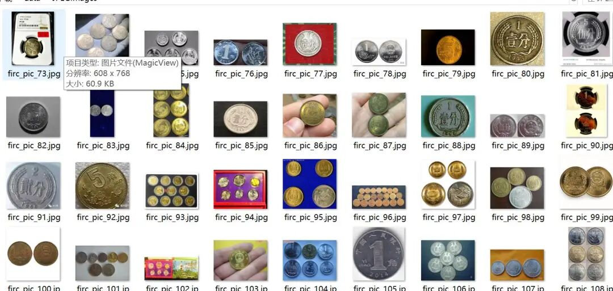
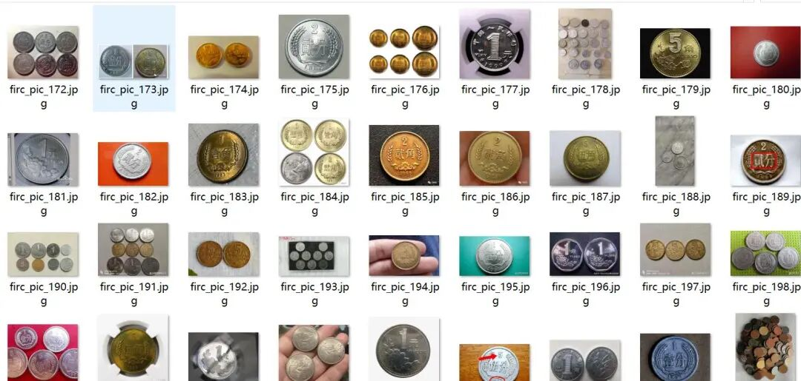
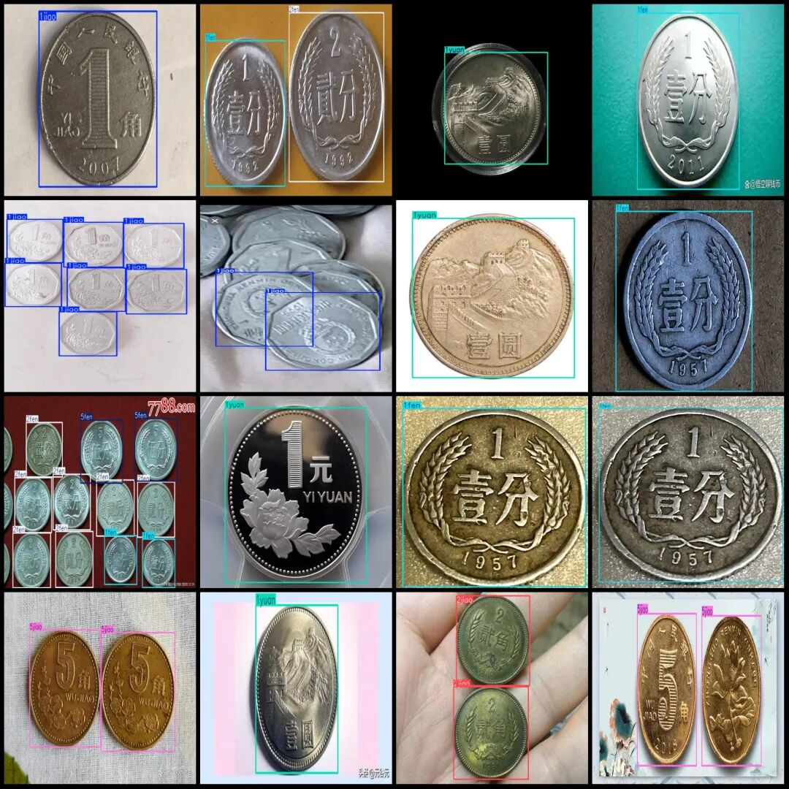
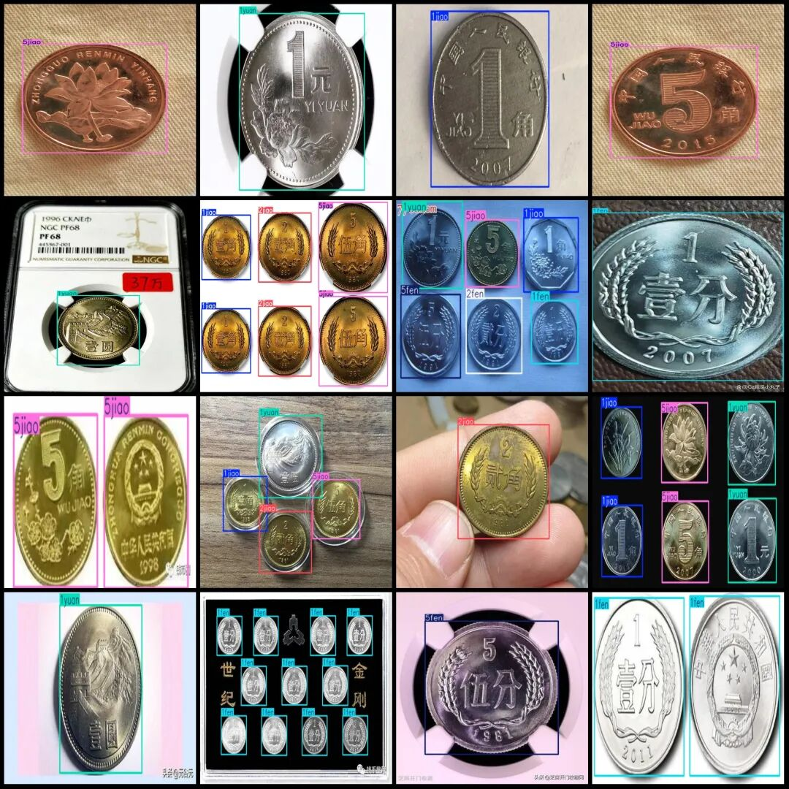

# Coin denomination detection dataset VOC+YOLO format with 230 images in 7 categories

Dataset format: Pascal VOC format + YOLO format (txt file without split path, only containing jpg images and corresponding VOC format xml files and yolo format txt files)

Number of images (number of jpg files): 230

Number of annotations (number of xml files): 230

Number of annotations (number of txt files): 230

Label category count: 7

Label category names (Note that the order of categories in the YOLO format does not correspond to this, but is based on the classes.txt file in the labels folder): ["1fen", "1jiao", "1yuan", "2fen", "2jiao", "5fen", "5jiao"]

Number of boxes labeled in each category:

1fen box = 72

1jiao Frames = 145

1 yuan frame = 161

2fen Frames = 84

2jiao Frames = 42

5fen box = 87

5jiao frame count = 209

Total frame count: 800

Number of images per category:

1fen occupancy of the image = 45

1jiao occupancy count = 73

1 yuan occupies the number of images = 91

2fen occupancy of images = 42

2jiao occupancy count = 25

5fen occupancy of the image = 46

5jiao occupies the number of images = 83

Image resolution: Multi-resolution images, such as 806x366, 500x375, etc.

Using labelImg:

Annotation rules: Draw a rectangle around the category.

Important Notice: The dataset does not have separate training, validation, and test sets; you need to partition them yourself.

Special : This dataset does not guarantee the accuracy of the trained models or weight files.

Image Preview:

Annotation example:

## Payment

Here is a pay link on Stripe ( https://buy.stripe.com/3cs8yP7sY87d0vu9AB ). Please contact me lonlonago@foxmail.com after funding $89, and I will send you a complete data files , thank you!

